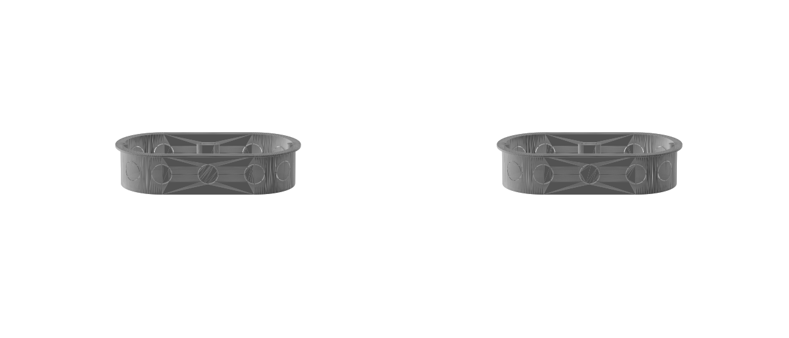
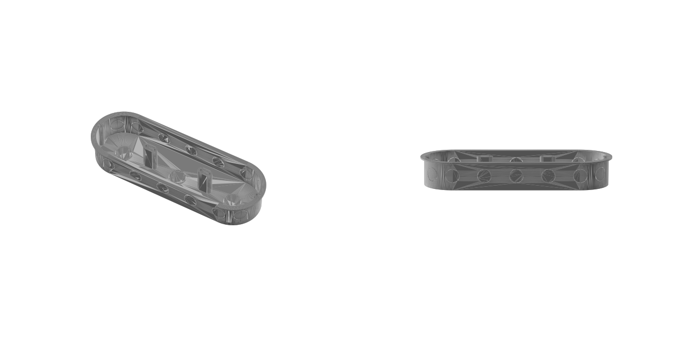

# Szerelvénydoboz 3D – kettes és hármas, 32 mm mély

3D nyomtatható, süllyesztett (falba építhető) **kettes** és **hármas** szerelvénydoboz FreeCAD modellje és kész STL fájljai.
A dobozok 71 mm-es szabványos osztással sorolják egymás mellé a 60 mm-es csavartávolságú szerelvényeket (kapcsoló, dugalj).

| Kettes | Hármas |
|---|---|
|  |  |

## Fájlok

| Fájl | Leírás |
|---|---|
| `szerelvenydoboz_kettes_32.FCStd` | Kettes doboz, paraméteres FreeCAD modell |
| `szerelvenydoboz_kettes_32.stl` | Kettes doboz, nyomtatható háló |
| `szerelvenydoboz_harmas_32.FCStd` | Hármas doboz, paraméteres FreeCAD modell |
| `szerelvenydoboz_harmas_32.stl` | Hármas doboz, nyomtatható háló |

## Főbb méretek

| | Kettes | Hármas |
|---|---|---|
| Befoglaló méret | 145 × 74 × 32 mm | 216 × 74 × 32 mm |
| Térfogat (anyag) | ~43,5 cm³ | ~65,8 cm³ |

- Mélység a perem tetejétől a hátlapig: **32 mm**
- Belső átmérő dobozonként: 62 mm, falvastagság: 2 mm, hátlap: 2 mm
- Perem: 74 mm széles, 1,5 mm vastag
- Dobozosztás: 71 mm, csavartávolság dobozonként: 60 mm (2,8 mm-es furat M3/M3,5 önmetszőhöz, 15 mm mély)

## Kialakítás

- **Lekerekített téglalap alak:** a felső és alsó oldalfal, valamint a perem egyenes; a két végén félkör.
- **Közös üreg:** a dobozok belseje össze van nyitva, így a vezetékek szabadon átvezethetők. A dobozhatároknál egy 9 mm-es borda tartja a két szomszédos csavartornyot.
- **Kitörhető kábelnyílások** (16 mm, 0,6 mm-es rés, 8 tartóhíd):
  - az egyenes oldalfalakon felül és alul minden doboz közepén és minden dobozhatárnál,
  - a szélső dobozokon a kifelé néző 45°-os helyeken,
  - minden doboz hátlapján egy 20 mm-es.

## Paraméterek

A modellek teljesen paraméteresek, a `Parameterek` táblázat celláinak átírásával módosíthatók (pl. `Melyseg`, `Doboz_tav`, `Belso_d`, `Fal_vastag`, `Kitoro_d`, `Borda_sz`). Az összes méret és kitörő automatikusan követi a változást.

## Nyomtatás

- Hátlappal lefelé nyomtatható, a perem felfelé néz. A perem 4 mm-rel nyúlik túl az oldalfalon – ez rövid túlnyúlás, de ha a szeletelő jelez, használj támaszt.
- A kitörők rése 0,6 mm; ügyelj rá, hogy a szeletelő ne töltse ki (pl. 0,4 mm-es fúvókával).
- A modellek FreeCAD 1.1-gyel készültek.
